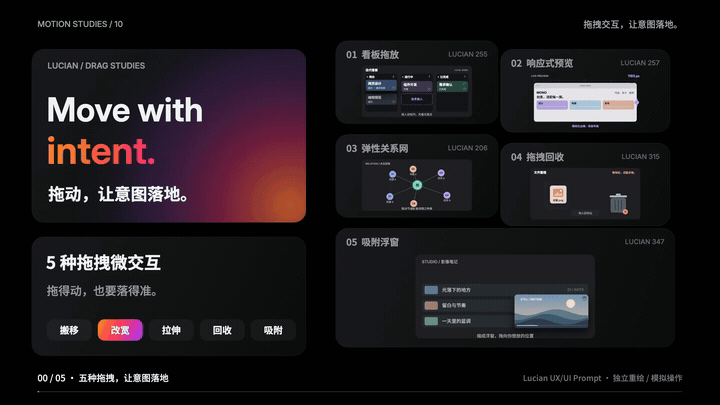

# vibe-MoveWith · 拖动，让意图落地

五种同类型的拖拽微交互，20 秒讲清 **适用场景 + AI 提示词 + 操作演示**。

**[在线演示与视频](https://jdb156158.github.io/vibe-MoveWith/)** · [下载 MP4](media/drag-microinteractions-20s.mp4) · [下载影片源码 ZIP](media/drag-microinteractions-source.zip)

## 视频效果

点击动图观看完整视频。20 秒 / 1920×1080 / 60fps，含原创合成配乐与音效。

[](https://jdb156158.github.io/vibe-MoveWith/#film)

## 亲手操作

|控件|使用场景|操作与反馈|
|---|---|---|
|看板拖放|任务管理|拖入目标列，留出落点，更新列计数；左右键移动。|
|响应式预览|适配检查|拖动手柄或选择设备宽度，实时换列和折叠菜单。|
|弹性关系网|关系探索|拖动节点，连线跟随，松手回弹；点击突出直接关系。|
|拖拽回收|文件整理|靠近开盖，投放回收，计数同步；撤销恢复原位。|
|吸附浮窗|边看边用|最小化后拖动，松手吸附角落，视频继续播放。|

支持鼠标、触屏、键盘与减少动态偏好。所有文件、任务、人物和内容均为本地教学示例，不涉及真实删除或业务提交。

结尾总结：**场景 + 动作 + 反馈。让每次拖动，都有明确落点。**

## 可复用组件提示词


### 01 / 看板拖放
为任务管理界面制作三列可拖拽看板：待办、进行中、已完成。抓起任务时轻微抬起并倾斜，鼠标和触屏拖动期间卡片跟手。进入目标列后先出现占位，其他卡片让出空间；松手落位后更新源列和目标列数量。放到已完成时显示完成状态。拖到无效区域时回原位，提供键盘移动和减少动态替代。计数与实际卡片数量保持一致。

### 02 / 响应式预览
为页面构建工具制作可拖动宽度的响应式预览。右边缘手柄跟随拖动，上方实时显示预览视口宽度；宽度跨过指定断点时，内容由三列变两列再变单列，导航折叠成菜单。卡片重排前让出目标位置，避免文字重叠。提供桌面、平板、手机快捷切换，以及键盘调宽功能。预览宽度读数必须与布局使用的断点逻辑一致。

### 03 / 弹性关系网
为关系探索界面制作可拖动的节点网络。抓取节点时，节点贴着指针移动，相关连线端点始终与节点连接；相邻节点轻微受牵引，松手后阻尼回弹，避免持续晃动和节点文字碰撞。点击节点可突出直接关系和关联数量，支持触屏拖动、键盘聚焦与减少动态模式。所有示例人物明确为演示数据。

### 04 / 拖拽回收
为文件整理界面制作拖拽回收站。文件靠近时桶盖逐渐打开，有效投放区域明确高亮；松手后文件缩小进入桶内，回收计数增加。显示可用的撤销按钮，撤销后文件回到原位置、计数恢复。拖出有效区域时不删除，支持键盘操作与触屏，不用模糊动画代替状态反馈。

### 05 / 吸附浮窗
为边看内容边浏览的页面制作可拖动视频浮窗。点击最小化，播放器缩成右下角小窗，原位置的内容自然补位。拖动时浮窗保持与指针的相对位置，松手后根据落点与释放速度吸附最近角落；先显示目标位置，再平滑落位。支持触屏、键盘移动和恢复原大小；限制在视口内，保留播放进度和可见的播放器控件。

## 整片制作提示词

```text
制作 20 秒、1920×1080、60fps 的拖拽控件知识短片。
五项：看板拖放、响应式预览、弹性关系网、拖拽回收、吸附浮窗。
每项显示适用场景、两行可复用 AI 提示词、完整的抓取/拖动/松手/结果。
沿用黑色 Bento 分区、Inter 大标题、中文短句和橙粉紫标题渐变。
五个控件在片头和片尾都同屏编号；讲到的主体放大，其他收为缩略卡。
指针按住时有反馈，方向与物体一致；看板有目标占位，缩窄预览时卡片换列，网络保持连接，文件可撤销，浮窗可吸附。
分镜：0–2 总览、2–5 看板、5–8 预览、8–11 关系网、11–14 回收、14–17 浮窗、17–20 总结。
最后落句：让每次拖动，都有明确落点。总结：场景 + 动作 + 反馈。
HTML Canvas 暴露 window.draw(t)，只由时间决定画面，字体与库全部本地加载。
120 BPM，2/4 拍，首拍零秒；章节切点对齐小节线；原创合成配乐和操作音效，完整乐句淡出。
先九帧检查，至少修改两轮；逐帧导出 1,200 张 JPG，再编码 H.264 yuv420p + AAC，faststart。
从实际 MP4 抽帧，验证完整播放、跳转和峰值，交付视频、总览、源码、提示词和制作步骤。
```

## 制作步骤

1. 核对 Lucian 255 / 257 / 206 / 315 / 347 的交互机制，确定场景、提示词和 20 秒分镜。
2. 使用 HTML Canvas 的确定性 draw(t) 构建五种操作和 Bento 卡片重排。
3. 九帧检查后进行两轮修订：解决小屏裁切、节点碰撞及断点重排遮挡；补查转场连续性。
4. Python 合成 120 BPM、2/4 拍配乐与交互音，20 小节完整乐句，结尾淡出。
5. Playwright 输出 1,200 帧，FFmpeg 编码 H.264 Main / yuv420p + AAC，启用 faststart。
6. 检查最终 MP4 抽帧、完整播放、跳转和音频峰值。
7. 把五种交互接入真实指针、触屏和键盘，检查拖动命中、状态反馈与窄屏。
8. 上传视频、源码与静态演示到 GitHub，Pages 从 main 根目录发布。

完整文档：[制作说明](docs/MAKING.md) · [提示词](docs/PROMPTS.md) · [分镜](film/treatment.md) · [影片验收](film/QA.md) · [网页验收](docs/QA.md)。

## 本地运行

```sh
python3 -m http.server 4858
```

打开 `http://localhost:4858/`。网页无需构建。复现影片进入 `film/`，安装 Node.js、Python/numpy、Chrome 与 FFmpeg，执行 `npm install`、`python3 make_audio.py`、`npm run render`、`sh encode.sh`。

## 目录

- index.html / site/：真实可操作的网页。
- film/：影片源码、音频合成与逐帧渲染脚本。
- media/：MP4、动态预览、总览图、源码 ZIP、浮窗演示视频。
- docs/：提示词、步骤与验收记录。

## 来源与许可


- [Lucian 255 · 看板拖放](https://lucianlabs.dev/uxui-prompt/#255)
- [Lucian 257 · 响应式预览](https://lucianlabs.dev/uxui-prompt/#257)
- [Lucian 206 · 弹性关系网](https://lucianlabs.dev/uxui-prompt/#206)
- [Lucian 315 · 拖拽回收](https://lucianlabs.dev/uxui-prompt/#315)
- [Lucian 347 · 吸附浮窗](https://lucianlabs.dev/uxui-prompt/#347)
- [观默 Bento Grid 视觉参考](https://guanmo-ai.github.io/design-style/?lang=zh#work-01-bento-grid)

影片 UI、几何、山景、文件图形、中文文案、动画和配乐独立编写。源站截图仅用于核实交互，未剪入成片。字体与依赖许可随源码保留。
